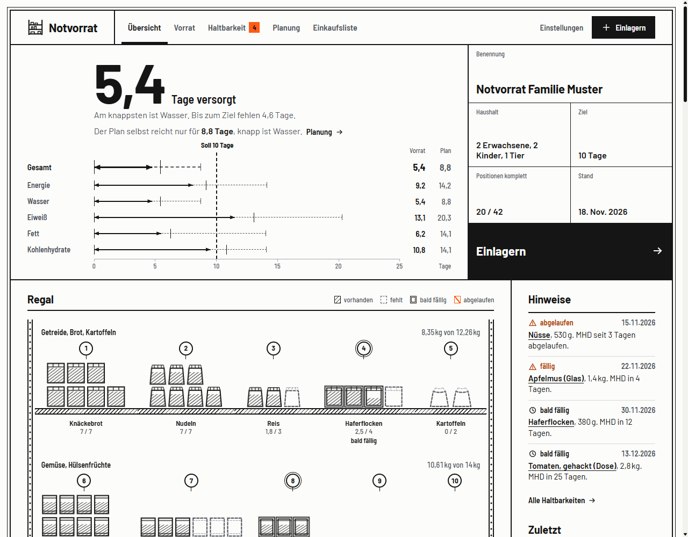
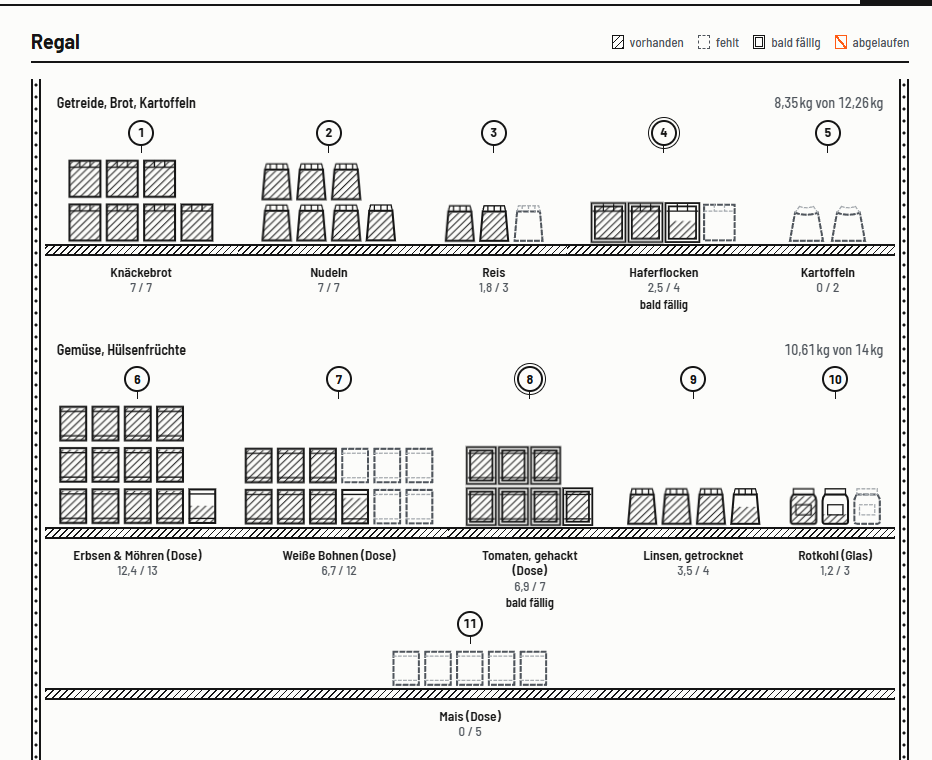
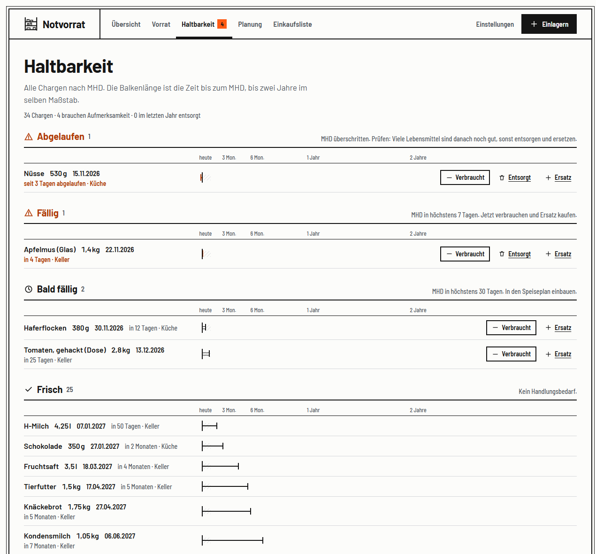
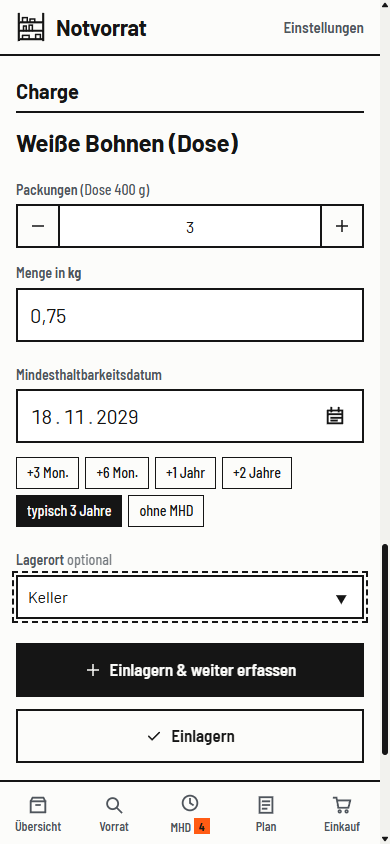
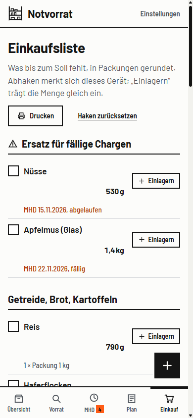
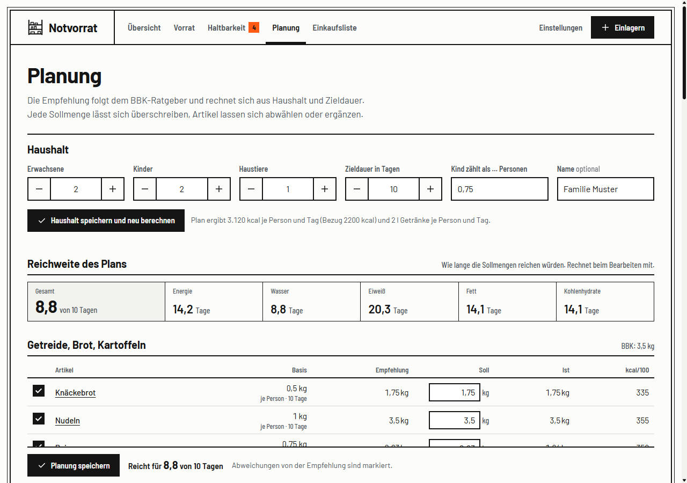

# Notvorrat

**Der Notvorrat eines Haushalts als Regal, das man auf einen Blick liest:** was da ist, was fehlt und was bald gegessen werden sollte. Die Sollmengen folgen dem Ratgeber des Bundesamts für Bevölkerungsschutz und Katastrophenhilfe (BBK), umgerechnet auf den eigenen Haushalt. Jede Charge hat ihr eigenes MHD, verbraucht wird immer die älteste zuerst, und eine tägliche Mail meldet, was bald fällig ist. Selbst gehostet, kleine PHP/MySQL-App ohne Build-Schritt.



## So sieht es aus

<table>
  <tr>
    <td width="50%"></td>
    <td width="50%"></td>
  </tr>
  <tr>
    <td><b>Regal.</b> Jede Packung ist gezeichnet: schraffiert, was da ist, gestrichelt, was fehlt, doppelt umrandet, was bald fällig ist. Die Nummern führen zur Stückliste darunter.</td>
    <td><b>Haltbarkeit.</b> Alle Chargen auf einer Zeitachse bis zwei Jahre. Was abgelaufen oder fällig ist, steht oben, mit „Verbraucht“, „Entsorgt“ und „Ersatz“ (lagert den Nachkauf gleich ein).</td>
  </tr>
</table>

<table>
  <tr>
    <td width="50%" align="center"></td>
    <td width="50%" align="center"></td>
  </tr>
  <tr>
    <td><b>Einlagern.</b> Artikel tippen, Packungen zählen, MHD per Knopf (+3 Monate … typische Haltbarkeit) oder vom Etikett. „Einlagern & weiter erfassen“ hält das Formular für den nächsten Artikel offen, so geht ein ganzer Einkauf im Stehen.</td>
    <td><b>Einkaufsliste.</b> Was bis zum Soll fehlt, in ganzen Packungen, dazu Ersatz für fällige Chargen. Abhaken merkt sich das Gerät, „Einlagern“ trägt die Menge gleich ein. Druckbar.</td>
  </tr>
</table>



**Planung.** Haushalt und Zieldauer einstellen, die Empfehlung rechnet sich neu. Jede Sollmenge lässt sich überschreiben, Artikel lassen sich abwählen oder mit eigenen Nährwerten ergänzen. Die Reichweite rechnet beim Tippen mit.

<sub>Screenshots mit Beispieldaten: zwei Erwachsene, zwei Kinder, ein Haustier, Ziel 10 Tage.</sub>

## Funktionen

- **Übersicht:** wie viele Tage der Vorrat reicht, getrennt nach Energie, Wasser, Eiweiß, Fett und Kohlenhydraten, gegen das Ziel und gegen das, was der Plan selbst hergibt. Dazu das Regal, Hinweise und die letzten Bewegungen.
- **Empfehlung nach BBK:** rund 40 Artikel in neun Gruppen (Getreide, Gemüse, Obst, Milch, Eiweiß, Fette, Getränke, Sonstiges, Notfall & Hygiene) plus Haustiere, mit Packungsgrößen und typischen Nährwerten.
- **Auf den Haushalt skaliert:** Erwachsene, Kinder (zählen standardmäßig 0,75), Haustiere und Zieldauer von 1 bis 90 Tagen.
- **Planung:** Sollmengen überschreiben, Artikel abwählen, eigene Artikel anlegen.
- **Vorrat nach Chargen:** jede Charge mit Menge, MHD und Lagerort. Verbrauchen nimmt immer die Charge mit dem frühesten MHD zuerst; einzelne Chargen lassen sich verbrauchen oder entsorgen.
- **Haltbarkeit:** Stufen „bald fällig“ (standardmäßig 30 Tage vorher), „fällig“ (7 Tage vorher) und „abgelaufen“, jeweils mit Text und Symbol, nicht nur Farbe.
- **Benachrichtigung:** Zähler in der Navigation, Hinweise auf der Übersicht und eine tägliche Sammelmail. Jede Charge wird pro Stufe nur einmal gemeldet.
- **Einkaufsliste:** Fehlmengen und Ersatz, in Packungen gerundet, druckbar.
- **Zugang:** ein gemeinsames Haushaltspasswort, angemeldet bleibt ein Gerät 30 Tage. Nach fünf Fehlversuchen ist der Login fünf Minuten gesperrt.
- **Für Handy und Rechner:** auf dem Handy mit Navigation am unteren Rand. Keine externen Anfragen: Schrift, Symbole und Zeichnungen kommen vom eigenen Server.

## Wie gerechnet wird

- **Soll.** Der BBK-Ratgeber nennt Mengen je Person für 10 Tage. Notvorrat rechnet sie auf die Personen (Kinder anteilig) und die Zieldauer um. Ausrüstung zählt je Person oder je Haushalt, Tierfutter je Tier.
- **Tage versorgt.** Energie im Vorrat geteilt durch 2.200 kcal je Person und Tag, Getränke geteilt durch 2 l je Person und Tag. Maßgeblich ist das Knappere. Eiweiß, Fett und Kohlenhydrate werden gegen Referenzmengen (55 g, 77 g, 286 g auf 2.200 kcal) gerechnet und zur Orientierung gezeigt.
- **Nährwerte** sind typische Richtwerte je 100 g oder ml, keine Angaben eines bestimmten Produkts. Für eigene Artikel trägt man sie selbst ein.

## Installation

**Voraussetzungen:** PHP 8.1 oder neuer mit `pdo_mysql` und `mbstring`, MySQL 5.7+ oder MariaDB 10.3+, PHP `mail()` für die Benachrichtigung und ein Cronjob (Kommandozeile oder Web-Cron). Kein Composer, kein Build-Schritt.

1. **Dateien hochladen:** `bin/`, `src/`, `public/`, `.htaccess` und `config.sample.php`.
2. **Document Root auf `public/` stellen.** Apache liest `public/.htaccess`. Für nginx:

   ```nginx
   root /pfad/zu/notvorrat/public;
   location / { try_files $uri $uri/ /index.php?$args; }
   ```

   Alles außerhalb von `public/` bleibt so unerreichbar. Zeigt die Domain bei Apache versehentlich auf den App-Ordner, sperrt die `.htaccess` dort alles.
3. **`config.sample.php` nach `config.php` kopieren** und ausfüllen:

   | Schlüssel | |
   |---|---|
   | `db` | Host, Port, Datenbank, Benutzer, Passwort |
   | `mail_from` | Absender der MHD-Mail. Sollte beim Hoster als Postfach existieren, sonst landet die Mail im Spam. |
   | `base_url` | optional, z. B. `https://vorrat.example.de`. Nur nötig, wenn der Cronjob läuft, bevor die App je im Browser geöffnet wurde. |
   | `timezone` | Standard `Europe/Berlin` |
   | `debug` | auf dem Server `false` |

4. **Seite aufrufen.** Beim ersten Aufruf werden die Tabellen angelegt (Präfix `nv_`) und die Empfehlung eingespielt. Danach Haushaltspasswort, Personen und Zieldauer festlegen.
5. **Mail prüfen:** unter *Einstellungen* die Adresse eintragen und „Test-Mail senden“.
6. **Cronjob einrichten**, einmal täglich. Der Befehl und der Web-Cron-Link stehen unter *Einstellungen*:

   ```
   0 7 * * *  php /pfad/zu/notvorrat/bin/mhd-digest.php
   ```

   Ohne Kommandozeile beim Hoster: `https://<adresse>/cron/mhd?token=<Token>` als Web-Cron.

Die App sollte über **https** laufen: Das Sitzungs-Cookie ist dann als `secure` markiert, und das Passwort geht nicht im Klartext übers Netz.

**Aktualisieren:** `bin/`, `src/`, `public/` und `.htaccess` ersetzen. `config.php` und die Datenbank bleiben, wie sie sind.

## Lokal entwickeln

```sh
cp config.sample.php config.php     # Datenbank eintragen, 'debug' => true
php -S localhost:8080 -t public public/index.php
```

Dann http://localhost:8080 öffnen. Der eingebaute PHP-Server reicht; `public/index.php` liefert Schriften, CSS und JavaScript dabei selbst aus.

- **Mails:** `mail()` braucht lokal einen Mailserver, z. B. [Mailpit](https://mailpit.axllent.org/) über `sendmail_path` in der `php.ini`. Die Sammelmail sofort auslösen: `php bin/mhd-digest.php --force` oder unter *Einstellungen* „Sammelmail jetzt senden“.
- **Neu anfangen:** alle Tabellen mit Präfix `nv_` löschen, beim nächsten Aufruf wird neu installiert.

## Aufbau

```
public/             Webroot: index.php (Front-Controller), .htaccess, assets/ (CSS, JS, Schriften, Logo)
src/
  bootstrap.php     Konfiguration laden, beim ersten Aufruf installieren
  routes.php        alle Seiten und Formulare
  model.php         Soll, Bestand, Reichweite, Chargen
  catalog.php       BBK-Empfehlung mit Packungen und Nährwerten
  drawing.php       das Regal als SVG
  mail.php          MHD-Sammelmail
  install.php, schema.sql
  views/            Seiten-Templates
bin/mhd-digest.php  Cronjob für die Sammelmail
```

## Dokumentation

- [PRODUCT.md](PRODUCT.md): für wen und wozu
- [DESIGN.md](DESIGN.md): das visuelle System

Schrift: Barlow (SIL Open Font License), lokal eingebunden.
